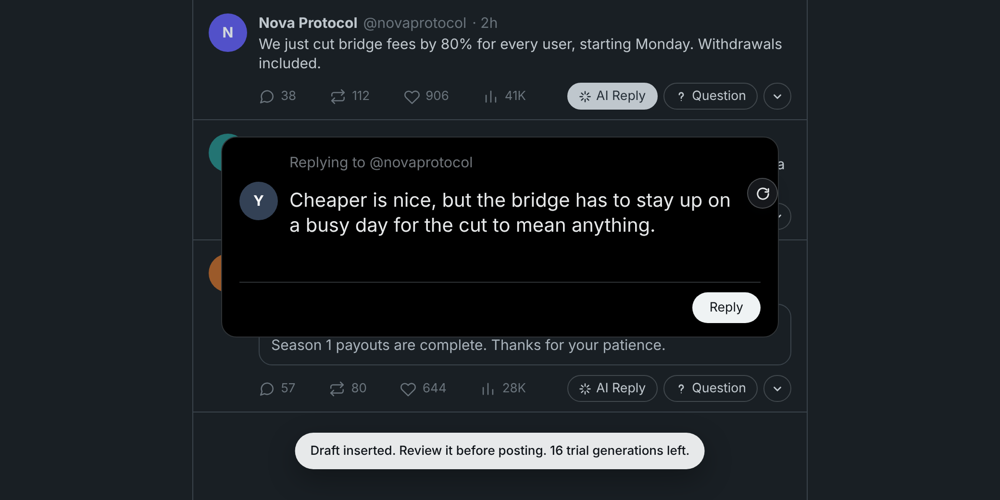
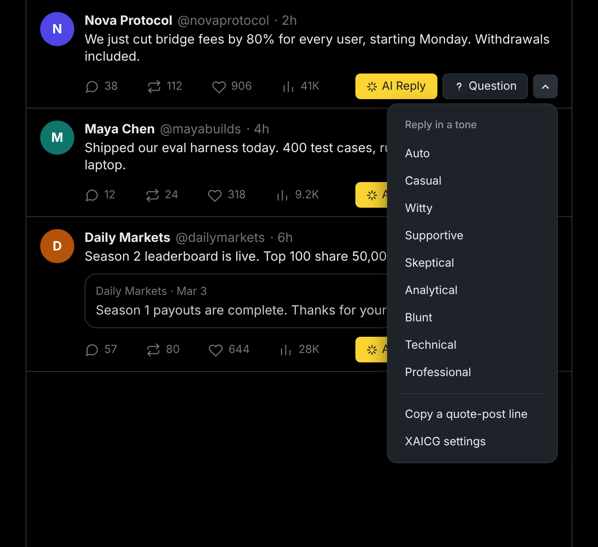
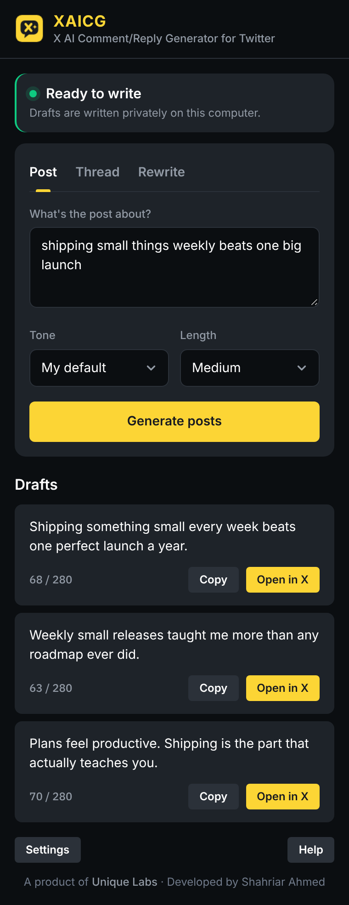
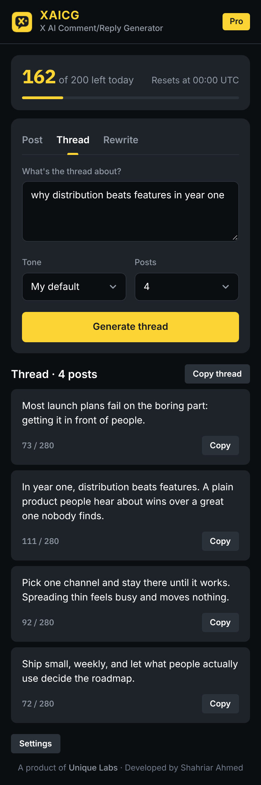

<div align="center">


<picture>
  <source media="(prefers-color-scheme: dark)" srcset="https://readme-typing-svg.demolab.com?font=Fira+Code&amp;weight=600&amp;size=22&amp;duration=3600&amp;pause=700&amp;color=FFB703&amp;center=true&amp;vCenter=true&amp;width=820&amp;height=48&amp;lines=Free+forever%2C+no+account%2C+no+API+key;Drafts+written+on+your+computer;Replies%2C+questions%2C+posts+and+threads;A+Chrome+extension+for+X;A+product+of+Unique+Labs" />
  <source media="(prefers-color-scheme: light)" srcset="https://readme-typing-svg.demolab.com?font=Fira+Code&amp;weight=600&amp;size=22&amp;duration=3600&amp;pause=700&amp;color=6C2BD9&amp;center=true&amp;vCenter=true&amp;width=820&amp;height=48&amp;lines=Free+forever%2C+no+account%2C+no+API+key;Drafts+written+on+your+computer;Replies%2C+questions%2C+posts+and+threads;A+Chrome+extension+for+X;A+product+of+Unique+Labs" />
  
</picture>

**X AI Comment/Reply Generator for Twitter.** A free Chrome extension that writes replies, questions, quote lines, posts and threads for X, in the user's own voice.

<br/>


<br/>

<a href="https://xaicg.uniquelabs.org"></a>
<a href="https://chromewebstore.google.com/detail/lpophlkocboadjhancbdikipnphffgil"></a>
<a href="https://www.uniquelabs.org"></a>
<a href="https://github.com/fr-ost"></a>

<br/>

**A product of [Unique Labs](https://www.uniquelabs.org). Developed by [Shahriar Ahmed](https://github.com/fr-ost).**

**Setting it up for the first time?** Follow [SETUP.md](SETUP.md). It goes step by step: the counting server, the website and the Chrome Web Store. This README is the reference.

</div>

---

## ✨ Overview

XAICG adds writing tools to X (Twitter) and to a small popup. Every draft is written on the user's own computer by the on-device language model that desktop Chrome provides to extensions (Chrome's Prompt API, the `LanguageModel` interface). Nothing about a post or a draft leaves the computer, and nobody pays per draft, which is why the product can be free with no limit, no account and no API key.

The server exists only to count. It learns that an install exists, its version, and how many drafts of each kind it wrote. The admin dashboard shows users (installs), active users and comments per day.

```
 Chrome extension (extension/)                                   XAICG server (server/)
 ┌──────────────────────────────────────────┐   counts only   ┌─────────────────────────┐
 │ buttons on every post, popup, settings    │ ──────────────▶ │ installs and drafts      │
 │ on-device AI model writes every draft     │  (no text)      │ per day, admin dashboard │
 │ cleanup and ranking (lib/engine/)         │                 └───────────┬─────────────┘
 └──────────────────────────────────────────┘                             PostgreSQL
```

> **Nothing that users read names the model or calls it Chrome's.** The extension, website, blog, store listing and policies say "on-device AI" or "an AI model that runs on your computer". Keep it that way in anything you add. The policies are still accurate: they say the text is processed on the user's computer and that the model is downloaded once.

<table>
<tr>
<td width="50%" align="center">

<br/><sub>AI Reply types a draft into X's box. Nothing is posted for the user.</sub>
</td>
<td width="50%" align="center">

<br/><sub>Auto and eight tones, plus a quote-post line.</sub>
</td>
</tr>
<tr>
<td width="50%" align="center">

<br/><sub>The popup writes posts in three lengths.</sub>
</td>
<td width="50%" align="center">

<br/><sub>Threads of three to eight posts.</sub>
</td>
</tr>
</table>

## ⚡ Key features

- **AI Reply** and **Question** buttons on every post on x.com, plus a tone menu with Auto and eight tones (casual, witty, supportive, skeptical, analytical, blunt, technical, professional) and a quote-post line.
- Drafts typed straight into X's reply box, or copied, if the user prefers. Nothing is ever posted for them.
- **Try another** steps through more drafts, as often as they like.
- A popup that writes posts in three lengths, threads of three to eight posts, and rewrites.
- A persona, default tone, length, language and emoji settings, and a memory of recent drafts so new ones do not repeat.
- English, Spanish, German, French and Japanese. Other languages get a clear message.
- Free, unlimited, no account, no API key. There is no cloud model and no fallback.

Computers that cannot run the on-device model see **Not available on this computer**. Chrome's requirements: desktop Chrome 138 or later on Windows 10/11, macOS 13+, Linux or a Chromebook Plus; about 22 GB free; a GPU with more than 4 GB of memory, or 16 GB of RAM and 4 cores.

## 🧰 Tech stack

| Piece | What it uses |
| --- | --- |
| Extension | Chrome Manifest V3, plain JavaScript. On-device drafts through Chrome's Prompt API (`LanguageModel`). |
| Cleanup | `extension/lib/engine/` ranks and cleans drafts: no dashes, no invented hashtags or links, generic praise ranked last, repeats of recent drafts penalized. |
| Prompts | `extension/lib/device-prompts.js`. Short and plain, written for a small model. |
| Setup card | `extension/lib/device-ui.js`. Ready, needs setup (one-time download with a progress bar), not available on this computer, or update Chrome. |
| Server | Node.js 22, [Fastify](https://fastify.dev), PostgreSQL (`pg`). Locally, embedded Postgres via PGlite when `DATABASE_URL` is unset. |
| Website | Plain HTML, CSS and three small scripts. Deployed on Vercel with Root Directory `website`. |
| Image | Root `Dockerfile` (`node:22-alpine`). Railway picks it up automatically. The extension folder is not part of the image. |

## 🚀 Getting started

You need Git, Node.js 22 or newer, and desktop Chrome on a computer that can run the on-device model.

```bash
git clone https://github.com/fr-ost/XAIGC.git
cd XAIGC
node --test "test/*.test.mjs"
cd server && npm install && npm test
```

The full path from an empty account to a published extension is [SETUP.md](SETUP.md): Railway for the counting server and Postgres, Vercel for the website, and the Chrome Web Store for the extension. The server's address is built into the extension. Changing it after launch means a new store release.

### Run the counting server locally

```bash
cd server
npm install
ADMIN_TOKEN=some-long-local-admin-token npm run dev
```

With no `DATABASE_URL`, the server uses an embedded Postgres (PGlite). The dashboard is at `http://localhost:8787/admin`. Health is `GET /health`.

### Load the extension

From the top of the repository, point a development copy at that server:

```bash
node scripts/set-api-url.mjs http://localhost:8787
```

Then in Chrome: `chrome://extensions`, turn on **Developer mode**, **Load unpacked**, and choose the `extension` folder. Switch the address back to your deployed server before packaging. `node scripts/pack-extension.mjs` refuses a build that reports to localhost.

## ⚙️ Configuration

Secrets are typed into the host's variables page (Railway) or exported in your shell. The server does not read `.env` files by itself. Never commit `APP_SECRET` or `ADMIN_TOKEN`.

Generate each secret with:

```bash
node -e "console.log(require('crypto').randomBytes(32).toString('base64url'))"
```

or `openssl rand -base64 32`.

| Variable | Required | What it is |
| --- | --- | --- |
| `NODE_ENV` | Production | `production` |
| `DATABASE_URL` | Production | Postgres connection string. Unset locally to use PGlite. On Railway: `${{Postgres.DATABASE_URL}}` |
| `APP_SECRET` | Production | 32+ random characters. Keys the network hashes that stop one network inflating the counts. |
| `ADMIN_TOKEN` | To open the dashboard | 24+ characters. The admin dashboard password. Leave unset to disable `/admin`. |
| `ALLOWED_ORIGINS` | Once published | Comma-separated origins, no trailing slash. Example shape: `chrome-extension://<extension id>` |

<details>
<summary><strong>Limits, database and hosting variables</strong> (defaults are fine)</summary>

<br/>

| Variable | Default | What it does |
| --- | --- | --- |
| `RL_IP_PER_MIN` | `120` | Requests per minute from one network. |
| `RL_DRAFTS_PER_DEVICE_PER_MIN` | `30` | Draft reports per minute from one install. |
| `DRAFTS_PER_DEVICE_PER_DAY` | `2000` | Daily cap per install. Reports past it are accepted but not counted. |
| `REGISTER_PER_IP_PER_HOUR` | `20` | New installs per hour from one network. |
| `DEVICES_PER_IP_PER_DAY` | `30` | New installs per day from one network. |
| `REREGISTRATIONS_PER_DAY` | `5` | How often one install may register again in a day after losing its token. |
| `CLIENT_IP_HEADER` | `x-real-ip` on Railway | Header that carries the caller's address. Set `none` to use the socket address. |
| `DATABASE_SSL` | unset | `true` to verify TLS, or `no-verify` (Supabase). |
| `DATABASE_SSL_CA` | unset | PEM of a private certificate authority. Newlines as `\n`. |
| `DATABASE_POOL_MAX` | `10` | Open connections. Lower it on small plans (`5` on small Supabase plans). |
| `PORT` | `8787` | Listen port. |
| `LOG_LEVEL` | `info` | Server log level. |
| `PGLITE_DIR` | unset | Embedded database directory. Empty means in-memory, for dev and tests only. |

Every setting is documented in [`server/.env.example`](server/.env.example).

Settings from earlier versions are ignored, and the server names them in its log at boot so you can delete them: `OPENAI_API_KEY`, `OPENAI_MODEL`, `OPENAI_BASE_URL`, `GOOGLE_CLIENT_ID`, `PLANS_JSON`, `FREE_DAILY_LIMIT`, `FREE_IP_DAILY_LIMIT`, `FREE_REQUIRE_SIGN_IN`, `FREE_GLOBAL_DAILY_CAP`, `GLOBAL_DAILY_CAP`, `TRIAL_GENERATIONS`, `BUY_URL`, `MODERATION`.

</details>

### Where the database lives

| Host | `DATABASE_URL` | Extra |
| --- | --- | --- |
| Railway Postgres | `${{Postgres.DATABASE_URL}}` | Nothing. |
| Supabase | Project, **Connect**, **Session pooler** string (port `5432`) | `DATABASE_SSL=no-verify`, and `DATABASE_POOL_MAX=5` on small plans. |
| Any other Postgres | Its connection string | `DATABASE_SSL=true` if it requires TLS. |

The server creates and upgrades its tables on boot. Every table has row level security enabled with no policies, so on Supabase the public API key can read nothing.

### Website addresses

`website/config.js` holds the site's addresses and the search-console verification codes. After changing it, run `node scripts/build-site.mjs`.

| Setting | What to put |
| --- | --- |
| `siteUrl` | The site's own address. Set by `node scripts/set-site-url.mjs <site address>`. |
| `googleSiteVerification`, `bingSiteVerification` | Verification codes from each search console (HTML tag method). |
| `chromeStoreUrl` | The extension's store address. While it is empty the buttons read "Coming soon". |
| `supportUrl` | Leave as `/support`. |
| `supportEmail` | The address people write to. While empty, contact goes to `contactUrl`. |

## 🖱️ Usage

On a computer that can run the model: load `extension/` unpacked, press **Set up** once and wait for the download, then press **AI Reply** on [x.com](https://x.com). The reply box opens with a draft in it. Nothing is posted.

| Surface | What it does |
| --- | --- |
| Buttons on each post | **AI Reply**, **Question**, a tone menu, and a quote-post line. |
| Popup | Posts in three lengths, threads of three to eight posts, and rewrites. Copy, or open in X. |
| Settings | Persona, default tone, length, language, emoji, insert-or-copy, the Question button, and sounds. |
| Admin dashboard | `https://<your-server>/admin`, signed in with `ADMIN_TOKEN`. Users, active users, comments per day. |

`kind` on a counted draft is one of `reply`, `question`, `quote`, `post`, `thread`, `rewrite`.

### Helper scripts

Run these from the top of the repository.

| Command | What it does |
| --- | --- |
| `node scripts/set-api-url.mjs <server address>` | Points the extension's counts at your deployed server. Updates `extension/config.js` and the host permission together. |
| `node scripts/set-version.mjs 4.1.0` | Sets the version of the extension and the server together. |
| `node scripts/pack-extension.mjs` | Makes the zip to upload to the Chrome Web Store. Refuses a build that reports to localhost. |
| `node scripts/build-site.mjs` | Rebuilds every page of the website, the sitemap, `robots.txt` and the blog's feed. Fails if a link between pages leads nowhere, or a title or description is missing or badly sized. |
| `node scripts/set-site-url.mjs <site address>` | Tells the website its own address and rebuilds it. |
| `node store/generate.mjs` | Rebuilds the store images and the website's screenshots. Needs Playwright. |
| `node store/build-icons.mjs` | Renders every icon size from `store/icon.svg`. |

## 🗂️ Project structure

| Path | What it is |
| --- | --- |
| `SETUP.md` | The step-by-step setup guide. |
| `extension/` | The Chrome extension (Manifest V3). Load this folder unpacked, or package it for the Chrome Web Store. |
| `server/` | The counting server: install registration, draft counts, admin dashboard. |
| `test/` | The extension's tests, run in Node with a stand-in for the on-device model. |
| `website/` | The product website, as plain files ready to serve. Deploys to Vercel with Root Directory `website`. |
| `content/` | What the website's pages are written from: the home page, about, contact, FAQ, and the blog (`content/blog/`, one Markdown file per article). |
| `store/` | Chrome Web Store material: `assets/` (screenshots, promo tiles, icon), `listing.md` (the text for every dashboard field) and the generator that makes the images from the real extension. |
| `scripts/` | Version, API URL, site URL, site build, and extension pack. |
| `Dockerfile` | Server image. Railway picks it up automatically. |
| `PRIVACY-POLICY.md`, `TERMS.md`, `SUPPORT.md` | The website's privacy, terms and help pages are built from these. |

## 🔢 The counting server

What it stores, and nothing else:

| Table | What | Why |
| --- | --- | --- |
| `devices` | A hash of the random install ID, a hash of the token, a keyed hash of the registering network, extension version, timestamps, total drafts | Counting users and active users; stopping one network inflating the counts |
| `usage_daily` | Per UTC day: total drafts (`drafts`), drafts per kind (`drafts:reply`...), and each install's own count for the daily cap | Comments per day on the dashboard |

| Endpoint | Purpose |
| --- | --- |
| `POST /v1/devices` `{installId}` | Register an install, get a token. Called once, on install. |
| `POST /v1/usage` `{kind}` | Count one draft. Anything else in the body is dropped before it is read. |
| `GET /health` | Health check. Returns `{"ok":true,"version":"..."}`. |
| `/admin`, `/admin/api/stats` | Dashboard. Bearer `ADMIN_TOKEN`. |

Abuse controls keep the numbers honest: new installs per network per hour and per day, draft reports per install per minute, and a daily cap per install (reports past it are accepted but not counted). With `ALLOWED_ORIGINS` set, only the published extension may report.

If the server is down, the extension works exactly the same. Counts from that time are simply lost.

### Deploying it on Railway

1. **Create the project.** In Railway: New Project, Deploy from GitHub repo, pick this repository. Railway finds the root `Dockerfile` and builds the server.
2. **Add the database.** New, Database, PostgreSQL. The first deploy fails until the variables are set. That is expected.
3. **Set variables** on the server service (not the database):

   | Variable | Value |
   | --- | --- |
   | `NODE_ENV` | `production` |
   | `DATABASE_URL` | `${{Postgres.DATABASE_URL}}` |
   | `APP_SECRET` | 32+ random characters |
   | `ADMIN_TOKEN` | 24+ random characters. This is the admin dashboard password. |
   | `ALLOWED_ORIGINS` | `chrome-extension://<your extension id>` once it is published |

4. **Expose it.** Settings, Networking, Generate Domain. If Railway asks for a port, accept the one it suggests, or set `PORT` to `8787`. Set the health check path to `/health`. Put the server on a domain you own before you submit to the store. Railway's `*.up.railway.app` address is fine for testing. Changing the server address after launch needs a new store release, because Chrome switches an extension off until the user approves a new permission.
5. **Check it.** `https://<your-domain>/health` returns `{"ok":true,"version":"..."}`, and `https://<your-domain>/admin` shows the dashboard after you enter `ADMIN_TOKEN`. The top of the dashboard says `You: <an address> via x-real-ip`. That should be your own public IP. A private address such as `10.x.x.x` is covered in [SETUP.md](SETUP.md).

<details>
<summary><strong>Upgrading from 3.x</strong></summary>

<br/>

Version 4 removes the OpenAI engine, plans, licenses, Google sign-in and the free allowance. The database migrates by itself and nothing is dropped: the old tables (`licenses`, `users`, `trial_counters`, `license_events`, `usage_events`) are simply no longer used, so a rollback stays possible. Once you are sure, you can remove them, and the personal data in `users`, with:

```sql
DROP TABLE IF EXISTS license_events, trial_counters, usage_events CASCADE;
ALTER TABLE devices DROP COLUMN IF EXISTS license_id, DROP COLUMN IF EXISTS user_id;
DROP TABLE IF EXISTS licenses, users CASCADE;
```

Revoke the OpenAI API key once 4.0 is live in the store.

</details>

## 🌐 The website

`website/` is plain HTML, CSS and three small scripts. Vercel serves the files as they are. The pages are generated by `node scripts/build-site.mjs` and committed. In Vercel: import this repository, set **Root Directory** to `website`, leave the framework preset on **Other**, and leave the build command and output directory empty.

| Page | Written in |
| --- | --- |
| Home (`/`) | `content/home.html` |
| Blog (`/blog`) and its articles | `content/blog/*.md`, one file per article |
| FAQ, About, Contact | `content/faq.md`, `content/about.md`, `content/contact.md` |
| Support, Privacy, Terms | `SUPPORT.md`, `PRIVACY-POLICY.md`, `TERMS.md` |

Every page is built with its own title and description, a canonical address, Open Graph tags and schema.org structured data (the free app on the home page, the questions on the FAQ, each article on the blog), plus `sitemap.xml`, `robots.txt` and an RSS feed. The live site is [xaicg.uniquelabs.org](https://xaicg.uniquelabs.org).

A new blog article is a new file in `content/blog/`, named like the others (`13-reply-to-big-accounts.md` becomes `/blog/reply-to-big-accounts`). It starts with `title`, `description` (70 to 165 characters), `date` and `tag`.

## 🎨 Design

The extension, the website, the admin dashboard and the store images share one design system: a near-black canvas (`#0B0E11`), white type and one accent, yellow (`#FCD535`), on every primary action, the wordmark and the headline claims. Cards are flat blocks a step lighter (`#1E2329`). The tokens live at the top of `extension/ui.css`, `extension/content.css`, `website/styles.css` and `server/src/admin-ui/admin.css`. The icon is `store/icon.svg`.

## 🧪 Tests

```bash
node --test "test/*.test.mjs"
```

The extension's tests: the engine, the cleanup and ranking, the background worker's messages and counts, every setup and error state, with a stand-in for the on-device model (Node has none).

```bash
cd server
npm test
```

The server's tests: registration, counting, the abuse limits, the origin check and the admin dashboard. `TEST_DATABASE_URL=postgres://...` runs them against a real Postgres server.

Neither can run the real on-device model. Try the extension on a computer that can.

## 🛠️ Operations

- `APP_SECRET` keys the network hashes. Changing it does no harm beyond resetting the per-network install limits.
- Rate limits are per process. The daily counts live in Postgres and stay exact.
- Client addresses come from `X-Real-IP` on Railway. Elsewhere set `CLIENT_IP_HEADER`. The admin dashboard header shows what the server sees for you.
- If the server is down, the extension works exactly the same. Counts from that time are simply lost.

## 👤 Credits

XAICG is a product of [Unique Labs](https://www.uniquelabs.org), developed by [Shahriar Ahmed](https://github.com/fr-ost), Co-Founder & COO.

[Website](https://xaicg.uniquelabs.org) · [Chrome Web Store](https://chromewebstore.google.com/detail/lpophlkocboadjhancbdikipnphffgil) · [Unique Labs](https://www.uniquelabs.org) · [Shahriar Ahmed](https://github.com/fr-ost)

## License

Proprietary. Copyright Unique Labs. All rights reserved.

<div align="center">


</div>
